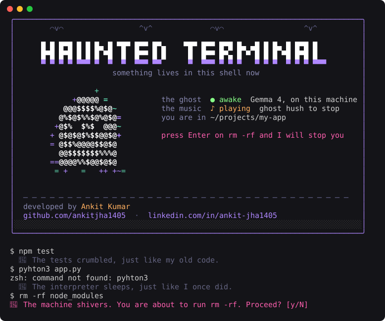

# 👻 haunted-terminal

**A ghost moves into your terminal.** Open a tab and it rises out of the dark while a horror soundtrack starts. Then it stays. It whispers about the commands you run, and stops you before you `rm -rf`.

The ghost is [Gemma 4](https://huggingface.co/ggml-org/gemma-4-E2B-it-GGUF), running on your own machine through [llama.cpp](https://github.com/ggml-org/llama.cpp). Your shell history never leaves your laptop.

[](https://github.com/ankitjha1405/haunted-terminal/actions/workflows/ci.yml)
&nbsp;**[Website](https://haunted-terminal-lovat.vercel.app)** · Built for the [DEV Hacktoberfest Open-Source AI Challenge, Week 4: Ghost in the Machine](https://dev.to/challenges/hacktoberfest-week4-2026-10-26)



Every ghost line above is real Gemma output from a laptop, about half a second each.

## What happens when you open a terminal

1. **The ghost rises.** A full-screen ASCII ghost fades in, bobs, blinks and fades out.
2. **The music starts.** A horror soundtrack loops for as long as any haunted tab is open, then stops when the last one closes.
3. **The welcome card.** The same ghost floats beside your status (is Gemma awake, is the music on, where you are) until you press a key.
4. **It stays.** After about one command in three, it whispers a line about what you just did. Every few commands, something in the room makes a sound: a whispered *boo*, a wolf howling, a witch cackling. Before a dangerous command runs, it asks you to confirm.

| It warns before | |
|---|---|
| `rm -rf`, `git clean -f` | deleting things for good |
| `git push --force`, `git reset --hard` | rewriting history |
| `DROP TABLE`, `DROP DATABASE` | losing data |
| `curl ... \| sh` | running the internet |
| `dd of=/dev/...`, `mkfs`, `chmod -R 777`, fork bombs | breaking the machine |

Press `y` to run it anyway, anything else to cancel.

## Install

You need zsh, Python 3.9 or newer, and about 3 GB of disk for the model. Built and tested on macOS. The ghost and the safety check should work on Linux too, but sound there is untested.

**1. Start Gemma.** The first run downloads the model.

```sh
brew install llama.cpp
llama-server -hf ggml-org/gemma-4-E2B-it-GGUF --port 8080
```

Leave it running in its own tab.

**2. Let the ghost move in.**

```sh
git clone https://github.com/ankitjha1405/haunted-terminal ~/.ghost
echo 'source ~/.ghost/ghost.zsh' >> ~/.zshrc
```

Or use the [installer](https://haunted-terminal-lovat.vercel.app/install.sh): `curl -fsSL https://haunted-terminal-lovat.vercel.app/install.sh | sh`. The ghost will warn you about piping the internet into a shell. Read [install.sh](install.sh) first.

**3. Open a new terminal window,** at least 70 columns wide, with the sound on.

To try it in one tab without installing, run `source ~/.ghost/ghost.zsh` in that tab. To remove it, delete the `source` line from `~/.zshrc`.

## Commands

| Command | What it does |
|---|---|
| `ghost hush` | Stop the music now. It comes back when you open a new haunted tab. |
| `ghost intro` | Play the rising ghost and the welcome card again. |
| `ghost check "<command>"` | Exit 1 and print a warning if the command is risky. |
| `ghost speak <exit_code> "<command>"` | Ask the ghost about a command. |
| `ghost scare [name]` | Play a horror sound now: `boo`, `wolf`, `witch`, `door`, `moan`, `chains` or `whispers`. |

## Settings

Put these in `~/.ghost/.env` (or `.env` next to `ghost.zsh`). Every haunted shell loads that file. It is git-ignored, so your keys stay out of the repo.

```sh
ELEVENLABS_API_KEY=your-key
```

| Variable | Default | What it does |
|---|---|---|
| `GHOST_INTRO` | on | `0` skips the rising ghost and the welcome card. |
| `GHOST_MUSIC` | on | `0` turns the soundtrack off. |
| `GHOST_CHANCE` | `0.35` | How often the ghost comments. `1` means every command. |
| `ELEVENLABS_API_KEY` | | Turns on the scares: horror sounds every 1 to 3 commands. |
| `GHOST_SCARES` | on | `0` turns the scares off even with a key. |
| `GHOST_VOICE` | off | `say` reads every ghost line aloud in the offline macOS whisper. |
| `GHOST_URL` | `http://127.0.0.1:8080/v1/chat/completions` | Any OpenAI-compatible endpoint. |

The scares are made once with the [ElevenLabs sound effects API](https://elevenlabs.io/docs/api-reference/text-to-sound-effects/convert) from seven fixed descriptions, then cached in `~/.cache/ghost/scares/`. After that, nothing is sent anywhere. ElevenLabs never sees your commands.

## How it works

```
~/.zshrc
  └─ ghost.zsh                     zsh hooks, loads .env, starts the music and the intro
       ├─ precmd       → ghost speak   ask Gemma about the last command
       ├─ accept-line  → ghost check   regex check before Enter, asks y/N
       ├─ on start     → ghost music   one shared player for all tabs
       └─ on start     → ghost intro   rising ghost, then the welcome card
ghost                              one Python file, standard library only
haunt.mp3                          the soundtrack
```

- **The ghost's voice** is a system prompt: a programmer who died in 1987 at a VT100, mid-COBOL migration, who answers in one cold sentence and never gives advice. Gemma 4 starts "thinking" when it gets a system prompt and spends every token on it, so the request sets `enable_thinking: false`.
- **The safety check is regex, not the model.** A warning before `rm -rf` has to be instant and right every time.
- **The ghost is a signed distance field:** a circle for the head and a box with a wavy hem for the body, drawn in `@$%` and lit by a violet and green halo. The same math draws the hero on the website.
- **The welcome card** redraws in place 20 times a second until a key is pressed. It uses only 256-colour codes, because macOS Terminal.app can't show 24-bit colour.
- **The music** has one player for every tab, guarded by an atomic lock file. Each shell registers its process ID, and the player stops when none of them are alive. If `haunt.mp3` is missing, `ghost` composes its own 48-second loop: a D drone with a sour E-flat, filtered-noise wind, and a detuned music box. Every frequency fits a whole number of cycles, so the loop has no seam.
- **The scares** count down in the shell: after each command, a counter drops, and at zero `ghost scare` plays a random sound in the background and resets the counter to 1, 2 or 3. The seven sounds are generated once and cached, so after the first few they cost no credits and work offline.
- **It never gets in your way.** If llama-server is down, `ghost speak` returns in milliseconds and says nothing.

## Why it runs locally

A terminal sees everything: file paths, hostnames, branch names, half-typed secrets. An open-weight model running on your laptop means the ghost works offline, costs nothing per command, and keeps your shell history yours. `GHOST_URL` points at any OpenAI-compatible server, so you can swap Gemma for any open model.

## Development

```sh
python3 -m unittest -v test_ghost.py   # 11 tests: risk patterns, prompt, fake llama-server, frames, card, music lock
zsh -n ghost.zsh                       # syntax check
```

The website is `site/index.html`, deployed on Vercel. The build copies `ghost`, `ghost.zsh`, `install.sh` and `haunt.mp3` into `site/` so the installer can download them.

## Credits

Developed by **Ankit Kumar**. [GitHub](https://github.com/ankitjha1405) · [LinkedIn](https://www.linkedin.com/in/ankit-jha1405)

- Model: [Gemma 4 E2B](https://huggingface.co/ggml-org/gemma-4-E2B-it-GGUF) by Google, served by [llama.cpp](https://github.com/ggml-org/llama.cpp).
- Music: "Horror Music" by kiravale, from [Pixabay](https://pixabay.com/), under the Pixabay Content License.
- Scares (optional): sound effects generated with [ElevenLabs](https://elevenlabs.io).

## License

Code: [MIT](LICENSE). `haunt.mp3`: Pixabay Content License.
